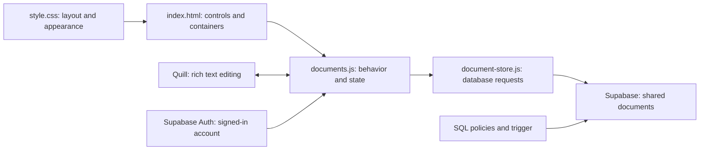

> This walkthrough describes the earlier document-editor version. The current three-section prototype is explained in [LEARNING-GUIDE.md](LEARNING-GUIDE.md); some line numbers and layout details below are historical.

# Engineering Notebook: a walkthrough of the current code

This guide describes the files inspected for this walkthrough. It explains the implementation; it does not change the app. Line numbers refer to the source files, not to this guide. Blank lines and lines that only close a tag, bracket, or brace are grouped with the code they finish.

The reading order follows the running app. The tests and package files are at the end because they are development tools, not part of what a teammate downloads to use the notebook.

Read sections 1-7 first for the main editor workflow. Read sections 8-9 for storage/access, section 10 when working on appearance, and sections 11-15 when you want to understand the development files. Sections 16-17 connect the code to your convenience concerns and give you ways to check your understanding.

### Contents

- [1. What you have built](#1-what-you-have-built)
- [2. JavaScript notation](#2-javascript-notation-used-throughout)
- [3. HTML](#3-indexhtml-the-pieces-the-browser-can-display)
- [4. Supabase connection](#4-supabase-clientjs-create-the-connection-object)
- [5. Section navigation](#5-scriptjs-your-existing-section-navigation)
- [6. Database requests](#6-document-storejs-make-database-requests)
- [7. Editor behavior, line by line](#7-documentsjs-coordinate-the-editor)
- [8. Tables and access rules](#8-supabasesetupsql-storage-and-access-rules)
- [9. Team enrollment](#9-supabaseadd-team-membersql-administrator-enrollment)
- [10. CSS](#10-stylecss-appearance-layout-and-responsive-rules)
- [11. Package files](#11-development-tools-packagejson-and-pnpm-lockyaml)
- [12. Test fixtures](#12-testsfixturescjs-prepare-disposable-postgresql-data)
- [13. Database tests](#13-testsdatabasetestcjs-check-behavior-and-access)
- [14. Browser test server](#14-testsbrowser-servercjs-a-disposable-app-for-browser-checks)
- [15. Git exclusions and README](#15-gitignore-and-readmemd)
- [16. Convenience and current limitations](#16-why-the-workflow-can-still-feel-inconvenient)
- [17. Trace it yourself](#17-trace-the-code-yourself)

## 1. What you have built

Your browser runs the interface. Quill supplies the writing and formatting behavior. Your JavaScript connects that editor to Supabase. Supabase handles signing in and runs the PostgreSQL database that holds shared documents.



The Python command only delivers your HTML, CSS, and JavaScript files to the browser. Python is not saving the documents. The Node files under `tests/` are not your production backend either: they provide a disposable environment for checking the app.

| File | Its job |
| --- | --- |
| `index.html` | Places the navigation, login controls, document list, toolbar, and editor on the page. |
| `style.css` | Positions and styles those elements. |
| `script.js` | Keeps your original section navigation working. |
| `supabase-client.js` | Creates the shared connection object used for authentication and database requests. |
| `document-store.js` | Defines the requests for membership, listing, opening, and saving documents. |
| `documents.js` | Coordinates the interface, Quill, accounts, and saving. |
| `supabase/setup.sql` | Creates tables, access rules, and automatic author/date/revision handling. |
| `supabase/add-team-member.sql` | Connects an existing account to a team. |
| `tests/fixtures.cjs` | Prepares disposable accounts and a test database. |
| `tests/database.test.cjs` | Checks the real SQL rules against that database. |
| `tests/browser-server.cjs` | Serves a disposable version of the app for browser checks. |
| `package.json`, `pnpm-lock.yaml` | Describe and pin development tooling. |
| `.gitignore`, `README.md` | Control Git exclusions and explain setup and usage. |

### Three different kinds of information

1. **Page elements:** things like the title input and Save button. JavaScript gets references to them so it can read or change them.
2. **Browser state:** variables such as `activeId` and `dirty`. These describe what is happening in the currently open app.
3. **Database records:** saved teams, memberships, and documents. These remain after you reload and can be read by authorized teammates.

Changing a variable does not itself change the database. Calling `store.save(...)` is the step that sends a database request.

### What happens during one save

1. You type. An event calls `markDirty()`.
2. The app records that the editor has unsaved changes.
3. You create a new document, or the autosave timer runs for an existing one.
4. `snapshot()` reads the title, mechanism, and formatted content.
5. `saveDocument()` passes that snapshot to `store.save(...)`.
6. `document-store.js` asks Supabase to insert or update a row.
7. Database rules check your team membership. A trigger assigns dates, authorship, and a revision.
8. Supabase returns the saved row. The app updates its state, list, and saved message.

The save response does not replace the editor's current contents. That is intentional: you might have continued typing while the request was traveling over the network.

## 2. JavaScript notation used throughout

| Notation | Meaning here |
| --- | --- |
| `const name = value` | Declare a binding that will not be reassigned. An object stored in it can still have its properties changed. |
| `let name = value` | Declare a binding that can later receive a different value. |
| `null` | An explicitly empty value, such as no signed-in user yet. |
| `[]` | An array: an ordered collection of values. |
| `{ title: "Notes" }` | An object with a property called `title`. |
| `ui.title` | Read the `title` property of the object `ui`. In this app that property contains an input element. |
| `ui.title.value` | Read the text currently inside that input. |
| `function name(...) { ... }` | Define instructions to run when the function is called. Defining it does not immediately run its body. |
| `id => document.getElementById(id)` | An arrow function taking `id` and returning the expression after the arrow. |
| `() => { ... }` | An arrow function with no parameters and a block body. A block body needs an explicit `return` to return a value. |
| `return value` | End the current function and give a result to its caller. A plain `return;` just ends it. |
| `!value` | Negate a value's truthiness: for example, `!null` is true. |
| `a && b` | Evaluate `b` only if `a` is truthy; often used to require both conditions. |
| `a \|\| b` | Use `a` if it is truthy; otherwise use `b`. This also supplies fallback strings. |
| `===`, `!==` | Compare values without JavaScript's loose type conversion. |
| `condition ? a : b` | Choose `a` when the condition is true, otherwise `b`. This is a ternary expression. |
| `user?.id` | Read `id` if `user` exists; produce `undefined` if it is null or undefined. This is optional chaining. |
| `{ revision }` | Object shorthand for `{ revision: revision }`. |
| `{ ...member, teamName: team.name }` | Make an object containing the member's properties and an additional `teamName` property. |
| `[saved, ...others]` | Make an array starting with `saved`, followed by every item in `others`. |
| `async function ...` | Define a function whose result is a Promise. A Promise represents an operation that may finish later. |
| `await request` | Pause this async function until the request settles. The browser can still respond to other events. |
| `try / catch / finally` | Try an operation; handle a thrown error in `catch`; run cleanup in `finally` whether it worked or failed. |
| `throw error` | Stop normal execution and send the error toward a surrounding `catch` or the caller. |
| `addEventListener("click", callback)` | Register the callback once. The browser calls it when a matching event happens. |
| `setTimeout(callback, 1000)` | Schedule a callback for at least roughly one second later. It does not freeze the page. |
| `.filter(...)`, `.some(...)`, `.sort(...)` | Select items into a new array, test whether any item matches, or reorder an array. |

You do not need to memorize the whole table before reading. Use it when unfamiliar notation appears.

## 3. index.html: the pieces the browser can display

Open [index.html](/C:/Users/Etern/Desktop/Capitol/index.html:1).

### Lines 1-18: document setup and dependencies

| Line | Explanation |
| --- | --- |
| 1 | `<!DOCTYPE html>` tells the browser to use modern HTML parsing and layout behavior. It is not a JavaScript requirement. |
| 2 | Starts the HTML document and identifies its language as English. |
| 4 | Starts metadata and resource declarations inside `head`. |
| 5 | Loads Quill's Snow stylesheet. This styles the editor controls Quill provides. |
| 6 | Loads your own stylesheet afterward, allowing your rules to override earlier styles where the cascade and specificity permit. |
| 7 | Sets the browser tab's title. |
| 8 | Declares UTF-8 text encoding. |
| 9 | Tells mobile browsers to use the device's viewport width rather than a wider simulated desktop layout. |
| 10 | Downloads the Supabase JavaScript library. `defer` lets HTML parsing continue and schedules this classic script to run after parsing. |
| 11 | Loads your connection settings and creates `notebookDb`. The Supabase library must run first. |
| 12 | Downloads Quill's JavaScript. Its CSS alone cannot provide editing behavior. |
| 13 | Loads your section navigation. |
| 14 | Defines the database-request helper used by the editor. |
| 15 | Runs the document workspace code after those dependencies. Deferred classic scripts execute in document order. |
| 16-18 | Finish the head and begin the visible document body. |

The URLs containing `cdn.jsdelivr.net` load third-party libraries into the browser. Your `.js` files connect those libraries to your particular interface.

### Lines 19-58: the outer page and deadline placeholder

| Line | Explanation |
| --- | --- |
| 19 | Creates the outer `.main` wrapper. CSS uses it to constrain page width and provide spacing. |
| 20 | Displays the small Engineering Notebook label. |
| 21 | Opens `.page`, the CSS grid containing the current section and deadline panel. |
| 23 | Creates the Overview section. Its ID is what the navigation link targets. |
| 24-25 | Adds its heading and ends that section. |
| 27 | Creates the deadline panel. It is outside the individual view sections, so your navigation does not hide it. |
| 28 | `<details>` supplies native expand/collapse behavior. You do not need JavaScript for that interaction. |
| 29 | `<summary>` is the clickable label for the details panel. |
| 30 | Displays temporary placeholder text. |
| 31-33 | Start the table, its header area, and the header row. |
| 34-37 | Define four column headings: completion, due date, task, and notes. |
| 38-41 | Finish the header and start a body row. |
| 42 | Adds a checkbox. Its checked state is currently only a browser control; this code does not save task completion to Supabase. |
| 43 | Contains a placeholder due date. |
| 44 | Contains a placeholder task title. |
| 45 | Contains your temporary notes text. It is static HTML, not editor data. |
| 46-48 | Finish the row, table body, and table. |
| 49-56 | An HTML comment explaining table tags. Comments are not displayed as page content. |
| 57-58 | Finish the collapsible element and deadline panel. |

### Lines 60-94: accounts and the document library

| Line | Explanation |
| --- | --- |
| 60 | Creates the Documenting view with `hidden`, so Overview appears first. |
| 61-62 | Create the header row and its heading. |
| 63 | Adds the New document button. `type="button"` prevents a form submission. It starts hidden until a team loads. |
| 64 | Ends the heading row. |
| 66 | Begins the sign-in form. JavaScript listens for this form's submit event. |
| 67-68 | Explain what signing in does. |
| 69 | Connects the Email label to `account-email` through `for`. Clicking the label focuses its input. |
| 70 | Creates an email input. `required` and `type="email"` provide browser validation; `autocomplete="username"` helps password managers recognize the account field. |
| 71-72 | Create the password label and masked input. `current-password` identifies a login password, rather than a new-password field. |
| 73 | A submit button that triggers the form's submit event. |
| 74 | A status area for checking, signing in, and errors. The ARIA attributes help assistive technology announce changes. |
| 75 | Ends the sign-in form. |
| 77 | Starts an initially hidden signed-in account row. |
| 78 | Leaves a paragraph for JavaScript to fill with your name and team. |
| 79-80 | Add Sign out and close the row. |
| 81 | Starts an initially hidden error notice. |
| 82 | Gives error text a place to appear. `role="alert"` makes it an announcement for assistive technology. |
| 83-84 | Add a retry button and end the notice. |
| 86 | Creates the initially hidden workspace containing the library and editor. |
| 87 | Marks the document library as an aside, with its accessible name taken from the heading's ID. |
| 88-89 | Start the library heading row and display Documents. |
| 90 | Adds the Refresh control that fetches teammates' saved changes. |
| 91 | Ends the heading row. |
| 92 | Reserves a paragraph for the team-sharing explanation. |
| 93 | An empty container. `renderDocuments()` fills it with groups and document buttons. |
| 94 | Ends the library aside. |

An empty HTML element is often deliberate: it provides a stable location that JavaScript can populate after a database request finishes.

### Lines 96-137: the editor

| Line | Explanation |
| --- | --- |
| 96 | Starts the editor form. A form can look like an editor; the element itself does not force a survey-like appearance. |
| 97-98 | Open the title/control row and its field group. |
| 99 | Supplies an accessible title label. The `.visually-hidden` class hides it visually while retaining the label for assistive technology. |
| 100 | Creates the editable title. `value` supplies the initial text; `autocomplete="off"` requests that the browser not offer ordinary form-history suggestions. |
| 101-104 | Create a Mechanism label and input. `placeholder="General"` is a hint, not an actual value. JavaScript supplies General when saving a blank value. |
| 105 | Ends the field group. |
| 106 | Adds the main submit button. It starts disabled; JavaScript enables it after membership loads. Its label changes to Save now after creation. |
| 107 | Ends the top control row. |
| 109 | Reserves a live status line for Draft, Saving, Saved, and error states. |
| 110 | Creates initially hidden conflict controls. |
| 111 | Provides an explicit way to replace the local draft with the currently saved record. |
| 112 | Provides a way to preserve a conflicting draft as a separate document. |
| 113 | Ends the conflict controls. |
| 115 | Creates the toolbar container that Quill is told to use. |
| 116 | Groups toolbar controls using Quill's `ql-formats` class. |
| 117 | The `ql-header` class tells Quill this select controls heading formatting. |
| 118 | Empty heading value means normal text; this is the default selection. |
| 119 | Value 1 means heading level 1. |
| 120 | Value 2 means heading level 2. |
| 121-123 | Finish the heading control group and begin the bold group. |
| 124 | `ql-bold` connects this button to Quill's bold format. The button has no text because Quill supplies its visual control. |
| 125-126 | End the bold group and begin the list group. |
| 127 | A `ql-list` button with `ordered` selects a numbered list. |
| 128 | The same format with `bullet` selects a bulleted list. |
| 129-130 | End the list group and toolbar. |
| 132 | Creates the paper-like visual wrapper. |
| 133 | Creates the empty element Quill transforms into an editable area. It is a `div`, not a `textarea`, because Quill manages rich text inside it. |
| 134-137 | Close the paper, form, workspace, and Documenting view. |

The toolbar's `type="button"` attributes matter: formatting should not accidentally submit the surrounding form.

### Lines 139-158: remaining views and navigation

| Line | Explanation |
| --- | --- |
| 139-141 | Create the initially hidden Whiteboard placeholder. |
| 143-145 | Create the initially hidden Resources placeholder. |
| 147 | Ends the main page grid. |
| 149 | Starts the navigation bar. CSS places it at the top even though it appears later in the HTML. |
| 150 | Links to Overview's ID. |
| 151 | Links to Documenting's ID. |
| 152 | Links to Whiteboard's ID. |
| 153 | Links to Resources' ID. |
| 154-158 | Close navigation and the outer document structure. |

## 4. supabase-client.js: create the connection object

Open [supabase-client.js](/C:/Users/Etern/Desktop/Capitol/supabase-client.js:1). The actual configured values are intentionally not repeated here.

| Line | Explanation |
| --- | --- |
| 1-2 | Comments identify which project settings belong in this browser file. |
| 3 | Stores your project's Supabase URL. It identifies the server to contact. |
| 4 | Stores the browser-appropriate publishable key. The key identifies the project/application; it is not a substitute for a user's login or database access rules. |
| 6-7 | Explain why the variable starts empty. |
| 8 | Declares `notebookDb`, initially null. `let` allows the next block to assign a client object. |
| 10 | Checks that both setting strings are present. This checks truthiness, not whether the credentials are valid. |
| 11 | Calls the Supabase library's `createClient` and stores its result. `window.supabase` is the library loaded by the CDN script. |
| 12 | Ends the conditional. |

Creating a client does not immediately sign a user in or create tables. It prepares an object with methods such as `auth.signInWithPassword()` and `from("documents")`. See the [official client initialization reference](https://supabase.com/docs/reference/javascript/initializing).

## 5. script.js: your existing section navigation

Open [script.js](/C:/Users/Etern/Desktop/Capitol/script.js:1).

| Line | Explanation |
| --- | --- |
| 1 | Finds Overview and stores the currently displayed section. It starts with Overview each time the script runs on a fresh page load. |
| 2 | Finds the links inside `.navbar`. This produces a collection of matching elements. |
| 4 | Loops over those links once while setting the page up. `forEach` itself is not constantly running. |
| 5 | Registers a click callback for this particular link. The browser calls it on future clicks. |
| 6 | Cancels the link's usual action of updating the hash and scrolling to its target. Your callback controls visibility instead. |
| 8 | Reads the clicked link's `href`, for example `#documenting`. |
| 9 | Uses that value as a selector to find the target section. |
| 11 | Hides the section that was visible. |
| 12 | Reveals the requested section. |
| 13 | Updates the variable so the next click knows what to hide. |
| 14-15 | Finish the click callback and initial loop. |

Hiding Documenting does not delete its editor. The DOM elements and JavaScript variables stay alive. That is why you can visit another section and come back without recreating everything.

This navigation does not change the URL or integrate with browser Back/Forward. That is one concrete reason it can feel less convenient than the app behavior you want.

## 6. document-store.js: make database requests

Open [document-store.js](/C:/Users/Etern/Desktop/Capitol/document-store.js:1).

This file does not decide how a button looks or when autosave runs. It gives `documents.js` four operations: find membership, list documents, open one, and save one.

### Lines 1-23: factory and membership lookup

| Line | Explanation |
| --- | --- |
| 1-2 | Describe this file's responsibility. It uses the client supplied to it; it does not hold account passwords. |
| 3 | Defines a function that accepts a Supabase client and returns an object of useful methods. This pattern is often called a factory. |
| 4 | Lists the document columns the app needs when opening or saving. This is a comma-separated query string, not a JavaScript array. |
| 6 | Defines a shared result-checking function. |
| 7 | Supabase query results can contain an `error` property. If one is present, throw it so the editor's error handler can deal with it. |
| 8-9 | Otherwise return the result's `data`. This lets calling code work directly with records. |
| 11 | Begins the object returned to the caller. Its methods retain access to `client`, `fields`, and `check`. |
| 12 | Defines an async method accepting the current account's user ID. |
| 13 | Starts a query against `team_members`, awaits its result, then passes that result through `check`. |
| 14 | Selects three membership fields, filters to this user, and asks for zero or one row. `maybeSingle()` returns one object or null rather than an array on success. |
| 15 | Checks whether no membership was returned. A valid login does not automatically imply a team membership. |
| 16 | Creates a readable missing-membership error. |
| 17 | Adds an application-defined error code. |
| 18-19 | Throws the error and ends this branch. |
| 20 | Starts a separate query for the team's ID and name. |
| 21 | Filters by the membership's team ID and expects exactly one row with `single()`. |
| 22 | Returns the membership's existing properties plus a convenient `teamName` property. |
| 23 | Ends this method. |

### Lines 25-34: list versus open

| Line | Explanation |
| --- | --- |
| 25 | Defines the list operation, accepting a team ID. |
| 26 | Starts a documents query and returns its checked result. |
| 27 | Selects metadata for the sidebar. It does not download each document's full body here. |
| 28-29 | Filters to the team, orders newest update first, and ends the method. |
| 31 | Defines an operation accepting a team ID and one document ID. |
| 32 | Selects all the fields named in line 4. |
| 33-34 | Requires the matching team and document, expects one row, and returns it. |

The explicit team filter makes the requested scope clear. The database's access policies remain the enforcement mechanism even if someone edits their browser's JavaScript.

### Lines 36-65: insert or update

| Line | Explanation |
| --- | --- |
| 36 | Accepts a snapshot of the editor and whether that document already exists. |
| 37 | Declares a variable that either branch can assign. |
| 38 | Chooses update behavior for an existing record. |
| 39-40 | Explain why the revision filter is present. |
| 41 | Starts an update request with an object containing the editable fields. |
| 42 | Sends the title. |
| 43 | Sends the mechanism. |
| 44 | Sends the Quill content object. |
| 45 | Limits the update to this team's document ID. |
| 46 | Also requires the revision we last opened or saved. Requests the resulting row, allowing zero matches so a stale revision can be handled deliberately. |
| 47 | Starts the alternative branch for a new document. |
| 48 | Starts an insert request. |
| 49 | Supplies the UUID already assigned to this draft. |
| 50 | Supplies the owning team. |
| 51-53 | Supply title, mechanism, and formatted body. |
| 54-55 | Ask for the inserted row and finish the branch. |
| 56 | Throw any query error, otherwise extract the returned document. |
| 57 | Checks whether an update returned no document. Another save or a change in access can cause this. |
| 58 | Creates an explanation that preserves the distinction between a failed match and a successful save. |
| 59 | Labels it `DOCUMENT_CONFLICT` for the editor's conflict branch. |
| 60-61 | Throws that error and ends the check. |
| 62 | Returns the saved document to `saveDocument()`. |
| 63-65 | Finish the save method, returned object, and factory function. |

For example, both users open revision 4. The first user's update matches revision 4, and the server changes it to 5. The second user's request still requires 4, so it updates zero rows. The app can preserve that user's draft instead of silently replacing the first user's work.

This is conflict detection. It does not merge two people's writing, and a revision number is not a stored version history.

## 7. documents.js: coordinate the editor

Open [documents.js](/C:/Users/Etern/Desktop/Capitol/documents.js:1).

This is the largest application file. Much of its length handles waiting, failed saves, account changes, and conflicting edits. The core editing loop is shorter: detect a change, take a snapshot, save it, update the displayed status.

### Lines 1-15: a private scope and references to the interface

| Line | Explanation |
| --- | --- |
| 1-2 | Comments describe a reading order and identify the separate navigation file. |
| 3 | Starts an arrow function that is called immediately at the end of the file. Its variables live in this function's scope rather than becoming separate global variables. |
| 4 | Defines `byId`, a short helper returning `document.getElementById(id)`. Calling `byId("entry-title")` returns the title input element. |
| 5 | Starts the `ui` object. This groups element references under convenient names; it is not database data. |
| 6 | Finds the document form, title input, and mechanism input. |
| 7 | Finds the save button, status line, and document-list container. |
| 8 | Finds New document and Refresh. |
| 9 | Finds the workspace and its sharing-description paragraph. |
| 10 | Finds the sign-in form, email input, and password input. |
| 11 | Finds the login button and login-status paragraph. |
| 12 | Finds the signed-in account row, account text, and sign-out button. |
| 13 | Finds the error notice, its message, and its retry button. |
| 14 | Finds the conflict actions and their two buttons. |
| 15 | Finishes the object. From now on, `ui.title` means the element found on line 6. |

IDs are a convenient way to find unique elements, not a requirement for using JavaScript. This app also uses class selectors, attributes, and Quill's API.

### Lines 17-36: explain errors and check dependencies

| Line | Explanation |
| --- | --- |
| 17 | Defines `showError`, which accepts an error object. |
| 18 | Uses the error's message, with a fallback if it is absent or empty. |
| 19 | Checks for either of two missing-table/schema error codes. `.includes` asks whether the array contains the code. |
| 20 | Substitutes an understandable setup message. |
| 21 | Tests for PostgreSQL's permission-denied code. |
| 22 | Explains a permissions problem while reminding the user that the draft remains open. |
| 23 | Checks common network-related words in the error message. This is a simple message heuristic, not a complete classification of every possible network failure. |
| 24-25 | Supplies a connection message and finishes the conditional. |
| 26 | Writes the message into the error paragraph as text. `textContent` does not interpret a message as HTML. |
| 27-28 | Reveals the notice and finishes the function. |
| 30 | Checks whether `notebookDb` is undeclared, empty, or Quill is unavailable. `typeof` can test an undeclared name without throwing a ReferenceError. `\|\|` short-circuits subsequent checks when appropriate. |
| 31 | Prevents submitting a login when dependencies are missing. |
| 32 | Sets a short login status. |
| 33 | Displays a fuller setup/loading error. `new Error(...)` creates the error object passed to `showError`. |
| 34 | Makes retry reload the page in this dependency-failure case. |
| 35-36 | Exits the enclosing immediate function, so code that needs Quill or Supabase does not continue. |

### Lines 38-50: initialize Quill

| Line | Explanation |
| --- | --- |
| 38 | Gives the existing Supabase client the shorter local name `client`. It does not make a second connection object. |
| 39 | Calls the factory from `document-store.js`, giving it this client. The result has `membership`, `list`, `open`, and `save` methods. |
| 40 | Creates a Quill instance inside `#editor`, with the configuration object that follows. |
| 41 | Chooses Quill's Snow theme. The matching stylesheet is loaded in HTML. |
| 42 | Supplies a placeholder for an empty document. |
| 43 | Connects the custom toolbar in your HTML to this editor. |
| 44 | Limits the formats this editor accepts to headings, bold, and lists. |
| 45 | Finishes construction and stores the Quill instance in `quill`. |
| 46 | Gives Quill's editable root an accessible textbox role. |
| 47 | Names that writing area Document content. |
| 48 | Identifies it as multiline for assistive technology. |
| 49 | Finds the generated heading-picker label and gives it an accessible name, if it exists. `?.` avoids calling a method on null. |
| 50 | Starts with editing disabled while the app checks the account and team. |

`quill` is the editor instance; `quill.root` is its editable DOM element. Your code uses Quill's methods to read and restore formatted content. See the [Quill API reference](https://quilljs.com/docs/api).

### Lines 52-67: state variables, one by one

| Line | Variable | What it remembers |
| --- | --- | --- |
| 52 | `user` | The signed-in account, or null. |
| 53 | `membership` | The account's team membership, or null until it loads. |
| 54 | `documents` | An array used to display the document library. It starts empty. |
| 55 | `activeId` | A UUID for the current draft/document. A UUID is an identifier, not the document text. |
| 56 | `revision` | The last server revision known for the current document. A new draft has none. |
| 57 | `created` | Whether the current draft already has a database row. |
| 58 | `dirty` | Whether the editor has changes that need saving. This is a programming term for unsaved state. |
| 59 | `editVersion` | A local counter incremented for edits. It detects typing that happens during a save. It is separate from the database revision. |
| 60 | `saveTask` | The Promise for an in-progress save, or null when no save is running. |
| 61 | `saveTimer` | The timer handle used to schedule/cancel autosave. It does not contain document data. |
| 62 | `switching` | Whether the app is changing documents or refreshing through a guarded operation. |
| 63 | `loadingDocument` | Whether a document body is being fetched. |
| 64 | `conflict` | Whether a save found that its expected record/revision no longer matched. |
| 65 | `sessionEpoch` | A counter for account/session transitions. Async work checks it before applying old results. |
| 66 | `sessionInitialized` | Whether account state has already been processed at least once. |
| 67 | `recoveryDraft` | A temporary in-memory draft preserved across an account/session transition for its original user. It does not survive a page reload. |

Two counters solve different problems. `editVersion` asks, “Did the person type more while this request was running?” `revision` asks, “Has the saved database document changed since the version we knew?”

### Lines 69-87: status text and available controls

| Line | Explanation |
| --- | --- |
| 69 | Defines a status helper with a default state of `ready`. |
| 70 | Replaces the status paragraph's text. |
| 71-72 | Sets `data-state`, which CSS can inspect, and ends the function. |
| 74 | Defines the function that synchronizes enabled/disabled controls with app state. |
| 75 | Converts `saveTask` to a boolean and combines it with switching/loading flags. Any of these makes the app busy for certain actions. |
| 76 | Chooses Save now for an existing document, otherwise Create document. |
| 77 | Disables saving without membership, during busy work, or during an unresolved conflict. |
| 78 | Disables New document while busy. |
| 79 | Disables Refresh while busy. |
| 80 | Disables Sign out while busy. |
| 81 | Disables Reload saved version while busy. |
| 82 | Disables Save draft as new document while busy. |
| 83 | Makes the title read-only during switching/loading. It remains editable during an ordinary network save. |
| 84 | Applies the same rule to mechanism. |
| 85 | Enables the writing area only when membership exists and switching/loading is not happening. Typing can continue during an ordinary save. |
| 86 | Applies the busy state to every generated document button. |
| 87 | Ends the function. |

Disabling a button is an interface safeguard, not database authorization. Supabase's SQL rules still decide which requests can succeed.

### Lines 89-96: remember the open document's ID

| Line | Explanation |
| --- | --- |
| 89 | Explains that this browser value is navigation state, not a backup of the body. |
| 90 | Defines a function accepting an ID or an empty value. |
| 91 | Starts a try block because browser storage may be unavailable. |
| 92 | Constructs a storage key specific to the team. |
| 93 | Stores the ID in `sessionStorage` if one is supplied. This is browser-tab session storage. |
| 94 | Otherwise removes that remembered ID. |
| 95-96 | Ignores a storage failure and ends the function. Losing this convenience should not prevent using the editor. |

Supabase authentication session persistence is separate and is handled by its client library. This helper only remembers a document ID.

### Lines 98-139: build the document list

| Line | Explanation |
| --- | --- |
| 98 | Defines the rendering function. Rendering here means constructing/updating the displayed library. |
| 99 | Removes the list container's previous children so the new rendering does not duplicate them. |
| 100 | Checks whether the array has zero documents. `!0` is true. |
| 101 | Creates a paragraph DOM element. |
| 102 | Gives it a CSS class. |
| 103 | Assigns the empty-library explanation as text. |
| 104 | Inserts that paragraph into the page. |
| 105-106 | Ends the function early for the empty case. |
| 108 | Creates a Map: mechanism name will be each key, and its documents array will be the value. |
| 109 | Loops through the current document array. |
| 110 | Creates an empty group array when a mechanism first appears. |
| 111-112 | Pushes the document into its group, then ends this loop. |
| 113 | Converts Map entries to an array, sorts by mechanism name, then loops through each `[mechanism, items]` pair. |
| 114 | Creates a section element for one group. |
| 115 | Assigns its CSS class. |
| 116 | Creates its heading. |
| 117 | Sets the heading text to the mechanism name. |
| 118 | Creates an unordered list for the group's documents. |
| 119 | Starts looping through the group's document records. |
| 120 | Creates a list-item wrapper. |
| 121 | Creates the document's button. |
| 122 | Makes it an ordinary button rather than a form submitter. |
| 123 | Assigns its appearance class. |
| 124 | Writes the record's ID into `data-document-id`. A later click handler reads this value. |
| 125 | Marks the current saved document with `aria-current="true"`. CSS uses this to highlight it. |
| 126 | Creates a strong element for the title. |
| 127 | Sets the title safely as text rather than interpreting it as HTML. |
| 128 | Creates a time element. |
| 129 | Stores the machine-readable timestamp in its `datetime` attribute. |
| 130 | Displays the date in the user's browser locale. |
| 131 | Puts title and date into the button. |
| 132 | Puts the button into its list item. |
| 133-134 | Puts the row into the group list and finishes the inner loop. |
| 135 | Puts the heading and list into the group section. |
| 136-137 | Puts the group into the library and finishes the outer loop. |
| 138-139 | Updates button availability and ends rendering. |

This function displays the `documents` array; it does not fetch that array. A database request must happen separately. Within each mechanism, the code preserves the documents' order from the current array.

### Lines 141-156: start an empty draft

| Line | Explanation |
| --- | --- |
| 141 | Defines the draft-reset operation. |
| 142 | Cancels a scheduled autosave from the previous state. |
| 143 | Generates a new identifier. |
| 144 | Clears the server revision. |
| 145 | Marks this draft as not yet inserted. |
| 146 | Starts with no unsaved user edits. |
| 147 | Clears the conflict flag. |
| 148 | Resets the local edit counter. |
| 149 | Supplies the initial title. |
| 150 | Clears the mechanism input. |
| 151 | Replaces the editor with an empty Quill document. Its newline is the normal minimum document content. `silent` avoids emitting an ordinary text-change event for this reset. |
| 152 | Clears undo history so Undo cannot bring text from the previous document into this one. |
| 153 | Hides conflict actions. |
| 154 | Displays the new-draft status. |
| 155-156 | Updates controls and ends the function. |

### Lines 158-174: take a snapshot and schedule autosave

| Line | Explanation |
| --- | --- |
| 158 | Defines a function that reads the current editor state into a data object. |
| 159 | Begins the returned object. |
| 160 | Includes the current ID, last-known revision, and member's team ID. `revision` uses property shorthand. |
| 161 | Removes surrounding title whitespace and uses Untitled document if the result is empty. |
| 162 | Does the same for mechanism, using General as its fallback. |
| 163 | Gets Quill's formatted contents, serializes to JSON, then parses it back into a plain copied object. This captures the body's data for this save. |
| 164-165 | Finish the returned object and function. |
| 167 | Defines the function called when the user changes title, mechanism, or body. |
| 168 | Marks the current content as needing a save. |
| 169 | Increments the local edit counter. |
| 170 | Cancels the previous autosave timer. |
| 171-172 | Choose an appropriate message for conflict, existing document, or uncreated draft. The second argument controls whether CSS shows an error color. |
| 173 | For an existing, non-conflicting document, schedule a save after one second. Each further edit cancels and restarts that wait. |
| 174 | Ends the function. |

That restart-on-each-edit behavior is called debouncing. It avoids sending a database request for every keystroke.

The body is not saved as an HTML page. Here is an example of the kind of Quill data this app stores:

```json
{
  "ops": [
    { "insert": "Wheel mount", "attributes": { "bold": true } },
    { "insert": "\n" }
  ]
}
```

This says to insert bold text followed by a newline. `ops` contains content/formatting instructions. The app saves a full document snapshot, rather than using change operations to merge live edits. Quill describes this format in its [Delta documentation](https://quilljs.com/docs/delta).

### Lines 176-202: save successfully without losing newer typing

| Line | Explanation |
| --- | --- |
| 176-177 | Comments explain insert versus update and why the edit counter matters. |
| 178 | Defines an asynchronous save function. |
| 179 | Cancels a scheduled save because a save is now being attempted. |
| 180 | Refuses to save without membership or while a conflict requires a user decision. Returns false to the caller. |
| 181 | If a save is already running, returns that existing Promise rather than starting a second overlapping save. |
| 182 | If the document exists and has no unsaved changes, reports success without sending another request. |
| 183 | Captures the current title, mechanism, body, and identity. |
| 184 | Records the local edit counter at the start of this request. |
| 185 | Records the current account/session epoch. |
| 186 | Displays Saving. |
| 187 | Starts a nested async operation immediately and stores its Promise in `saveTask`. Other handlers can see that a save is running. |
| 188 | Begins its error-handling try block. |
| 189 | Calls the store's insert/update operation and waits for the saved record. |
| 190 | Ignores the result if the account/session changed while the request was running. It does not undo a write already accepted by the server. |
| 191 | Records the returned document ID. |
| 192 | Records its server-assigned revision. |
| 193 | Marks the document as created, including after a first insert. |
| 194 | Keeps `dirty` true if more typing happened since line 184. Otherwise the captured snapshot matches the current editor. |
| 195 | Makes a new array beginning with the saved record, removing the older library entry with that ID. |
| 196 | Sorts that array by newest `updated_at` first. These returned ISO timestamps can be compared as strings here. |
| 197 | Remembers this open document ID for the tab. |
| 198 | Renders the updated library. |
| 199 | Hides any earlier general error notice. |
| 200 | Reports either remaining unsaved changes or a successful server save with a displayed time. |
| 201 | If newer typing remains, schedules another save after one second. |
| 202 | Returns success for this completed save operation. It does not promise that all subsequent typing has already been saved. |

Example: the request captures edit counter 8. While it is running, you type again, raising the counter to 9. When the response arrives, line 194 sees that 9 is not 8. It leaves the newer editor contents alone and schedules another save. This is why the function does not call `quill.setContents(saved.content)` on every response.

### Lines 203-229: failed saves and finishing pending work

| Line | Explanation |
| --- | --- |
| 203 | Starts handling a thrown request error. |
| 204 | Ignores error results belonging to an earlier account/session epoch. |
| 205 | Keeps the draft marked unsaved. |
| 206 | Recognizes the store's conflict code or PostgreSQL's duplicate-key code. |
| 207 | Marks the app as in conflict. |
| 208 | Reveals the reload/copy choices. |
| 209 | Explains that the draft remains available. |
| 210-212 | For other failures, show a failed-save status and the general error notice. |
| 213-214 | Finish that branch and return false. |
| 215 | Starts cleanup that runs after either success or failure. |
| 216 | Clears the in-flight save Promise from state. |
| 217-219 | Update controls and finish the nested immediately invoked operation. |
| 220 | Updates controls after starting the request, so busy actions become disabled. |
| 221-222 | Return the save Promise to whoever requested the save and end the function. |
| 224 | Defines a helper for switching documents, refreshing, or signing out safely. |
| 225 | Cancels the autosave timer so this helper can handle saving directly. |
| 226 | If a save is running, wait for it. If it reports failure, stop and return false. |
| 227 | If an existing document still has unsaved edits, save them now and return that result. |
| 228-229 | Otherwise allow continuing only when there is no conflict. |

A save failure preserves the draft in the currently running page. It does not create an offline backup that survives closing the browser.

### Lines 231-264: show or fetch a saved document

| Line | Explanation |
| --- | --- |
| 231 | Defines how a returned database record is displayed. |
| 232 | Requires a content object with an `ops` array whose entries insert strings. This version rejects embed-style inserts such as images. |
| 233-234 | Throw an understandable error if the content shape is unsupported. This is a compatibility check, not a complete validator of every Delta attribute. |
| 235 | Set the current document ID. |
| 236 | Set its last-known server revision. |
| 237 | Mark that it already exists. |
| 238 | Its loaded contents start clean. |
| 239 | Clear the previous conflict state. |
| 240 | Reset the local edit counter for this loaded record. |
| 241 | Populate the title input. |
| 242 | Populate mechanism. |
| 243 | Restore the saved rich text through Quill without an ordinary text-change event. |
| 244 | Clear history so Undo does not cross documents. |
| 245 | Hide old conflict actions. |
| 246 | Hide old general error notices. |
| 247 | Remember this open ID. |
| 248 | Show the record's saved time. |
| 249 | Re-render the library, including its current-document highlight. |
| 250-251 | Update controls and finish display. |
| 253 | Define a fetch operation for one ID. |
| 254 | Capture the current session epoch. |
| 255 | Mark that loading is in progress. |
| 256 | Disable relevant controls/editing during the load. |
| 257 | Start a try block. |
| 258 | Fetch the document using team ID and document ID. |
| 259 | Display it only if the account/session epoch still matches. |
| 260 | Begin cleanup regardless of fetch success. A thrown error can still pass outward to the caller. |
| 261 | Clear the loading flag. |
| 262-264 | Update controls and finish cleanup/function. |

`loadDocument()` gets data; `showDocument()` puts already-received data into the interface.

### Lines 266-281: guard document changes

| Line | Explanation |
| --- | --- |
| 266 | Explains the purpose: protect failed saves and uncreated drafts. |
| 267 | Defines a wrapper accepting an action function to run once navigation is safe. This is editor navigation, separate from `script.js` section visibility. |
| 268 | Prevent starting another guarded operation while one is running. |
| 269 | Mark switching active. |
| 270 | Lock relevant controls and editing. |
| 271 | Start a try block. |
| 272 | Finish pending saves. Stop this operation if they fail. |
| 273 | If the current draft was never created and has edits, require an explicit discard decision before moving away. |
| 274 | Run the supplied action and wait if it is asynchronous. |
| 275-276 | Display any error it throws. |
| 277 | Begin cleanup even if an early return happened inside the try block. |
| 278 | Release the switching flag. |
| 279-281 | Restore appropriate controls and finish the wrapper. |

Passing a function lets the same safeguard protect several different actions. For example, a caller can supply `() => loadDocument(id)` or a function that resets the editor.

### Lines 283-319: apply a signed-in or signed-out account

| Line | Explanation |
| --- | --- |
| 283 | Defines account-state handling. `force` defaults to false. |
| 284 | Skip redundant handling if the same user's state was already initialized, unless a forced retry was requested. Optional chaining allows a null session/user. |
| 285 | Before changing account state, check whether the previous user had an unsaved team draft. |
| 286-287 | Keep an in-memory snapshot tied to that user's ID and whether its row exists. |
| 288 | Increment the session epoch and store that new number for this async run. |
| 289 | Mark the session state initialized. |
| 290 | Cancel any scheduled autosave from the previous state. |
| 291 | Set `user` from the session, or null if signed out. |
| 292 | Clear the previous membership while checking the new state. |
| 293 | Clear the previous document array. |
| 294 | Remove its displayed list. |
| 295 | Hide the workspace until access is confirmed. |
| 296 | Hide New document for the same reason. |
| 297 | Hide old notices. |
| 298 | Hide the sign-in form when there is a signed-in user. |
| 299 | Hide the signed-in account row when there is no user. |
| 300 | Disable body editing. |
| 301 | Clear the displayed document by resetting to an empty draft. |
| 302 | Start the signed-out branch. |
| 303 | Clear account text. |
| 304 | Clear the previous sharing description. |
| 305 | Restore the initial login instruction. |
| 306-307 | End processing for signed-out state. |
| 308 | While signed in but still loading, display the email and a loading message. |
| 309 | Start membership/list request handling. |
| 310 | Look up this account's membership and team name. |
| 311 | Fetch the team's document metadata. |
| 312 | Ignore these results if another session transition occurred in the meantime. |
| 313 | Store the fetched membership. |
| 314 | Store the fetched document list. |
| 315 | Display the member's chosen display name and team. |
| 316 | Explain how teammates' changes become visible. |
| 317 | Reveal the workspace. |
| 318 | Reveal New document. |
| 319 | Enable Quill editing now that membership loaded. |

Login and membership answer different questions: “Who signed in?” and “Which shared notebook may this person use?” The account you created in Authentication and the membership row you added provide those two answers.

### Lines 320-343: recover an in-memory draft or reopen the last document

| Line | Explanation |
| --- | --- |
| 320 | Check whether the temporary recovery draft belongs to the now-signed-in user. |
| 321 | Keep a local reference to that recovery data. |
| 322 | Clear the global recovery slot once it is being consumed. |
| 323 | Restore its document ID. |
| 324 | Restore its last-known server revision. |
| 325 | Restore whether it already exists. |
| 326 | Restore the title. |
| 327 | Restore mechanism. |
| 328 | Restore the body silently. |
| 329 | Mark it unsaved again, scheduling autosave if it is an existing document. |
| 330 | Otherwise begin the usual remembered-ID path. |
| 331 | Declare a variable for the remembered ID. |
| 332 | Try reading this team's last-opened ID from session storage. Ignore storage restrictions. |
| 333 | Reopen it only if it is present in the newly authorized document list. |
| 334 | Finish the recovery/remembered-ID branch. |
| 335 | Display the document library. |
| 336 | Synchronize controls. |
| 337 | Handle membership/list/open failures. |
| 338 | Show the failure only if this session epoch is still current. |
| 339 | Keep the account email visible even if team loading failed. |
| 340 | Display the error notice. |
| 341-343 | Finish error handling and the account-state function. |

### Lines 345-372: editing, submitting, shortcuts, and document selection

| Line | Explanation |
| --- | --- |
| 345 | Subscribe to Quill's text-change event. Its arguments describe the change, previous contents, and source. Leading underscores signal intentionally unused parameters. |
| 346-347 | Mark unsaved changes only for a user-originated change, then end the callback. |
| 348 | Title input changes also mark the document dirty. Passing `markDirty` registers the function; `markDirty()` here would call it immediately instead. |
| 349 | Mechanism input changes do the same. |
| 350 | Register an async handler for submitting the editor form. |
| 351 | Prevent the browser's ordinary form submission/navigation. |
| 352-353 | Save through JavaScript and end the handler. |
| 354 | Listen for key presses inside the form. |
| 355 | Recognize Ctrl+S or Command+S. Converting the letter to lowercase makes the comparison consistent. |
| 356 | Prevent the browser's Save Page action. |
| 357-359 | Request a document save and finish the shortcut handler. |
| 360 | On New document, use the guarded `navigate` wrapper. The inner callback describes what to do once it is safe. |
| 361 | Reset to a new empty draft. |
| 362 | Clear the remembered open-document ID. |
| 363 | Re-render so the old document is no longer marked current. |
| 364 | Move keyboard focus to the title input. |
| 365-366 | Select its initial title text so typing replaces it, then close the nested callbacks. |
| 367 | Listen once on the document-list container. This works even when the buttons are rebuilt later. |
| 368 | Find the clicked document button, including when the click was on its nested title/date. `closest` searches the target and its ancestors. |
| 369 | Continue only for a document button and when it is not the already-open saved record. |
| 370 | Guard the change, then load the ID stored in that button's data attribute. |
| 371-372 | Finish the selection handler. |

The list-container technique is called event delegation. Clicks bubble from the title/date to the button and its containing list; you do not need to attach a new listener to every rebuilt button.

### Lines 373-401: refresh and resolve conflicts

| Line | Explanation |
| --- | --- |
| 373 | Register the Refresh button's async callback. |
| 374 | Ignore it while another switch is in progress. |
| 375 | Mark switching in progress. |
| 376 | Temporarily disable controls/editing that could race with the refresh. |
| 377 | Remember the session epoch for these requests. |
| 378 | Begin error handling. |
| 379 | Save outstanding edits before replacing saved content. Stop if saving fails or a conflict remains. |
| 380 | Request the latest team document list. |
| 381 | Ignore a response from an obsolete session epoch. |
| 382 | Replace the local document list. |
| 383 | If a saved document is currently open, fetch its latest contents too. A new uncreated draft is not replaced. |
| 384 | Render the refreshed list. |
| 385 | Display refresh errors. |
| 386-387 | Always release the switching lock and update controls. |
| 388 | Register Reload saved version. |
| 389 | Explain that reloading will replace the unsaved draft and require the user's confirmation. Cancel stops the callback. |
| 390-391 | Fetch/show the current saved document, or display its error. |
| 392 | Register Save draft as new document. |
| 393 | Clear the conflict flag to permit a new insert. |
| 394 | Mark this as a new document rather than an update of the conflicting record. |
| 395 | Clear its server revision. |
| 396 | Generate a new ID, leaving the existing record untouched. |
| 397 | Add `(copy)` to the current title, with an Untitled fallback. |
| 398 | Hide the conflict controls. |
| 399 | Mark the preserved contents as needing a save. |
| 400-401 | Insert the copy using the normal save function. |

### Lines 402-427: login, logout, and retry

| Line | Explanation |
| --- | --- |
| 402 | Register the sign-in form's async submit handler. |
| 403 | Prevent ordinary form navigation. |
| 404 | Temporarily disable Sign in against repeated submits. |
| 405 | Display Signing in. |
| 406 | Begin error handling. |
| 407 | Ask Supabase Auth to sign in. Destructuring extracts `data` and `error` from the returned object. |
| 408 | Read the email and password from the inputs. Trim email whitespace; do not trim the password because spaces can be meaningful. |
| 409 | Finish the request arguments and await its result. |
| 410 | Throw a returned auth error so the catch branch can show it. |
| 411 | Clear the password input after a successful response. |
| 412 | Apply the returned session, which starts membership/document loading. |
| 413-414 | Display a sign-in error with a fallback message. |
| 415-416 | Re-enable the button regardless of outcome and end the callback. |
| 417 | Register Sign out inside the navigation safeguard, so existing edits are dealt with first. |
| 418 | Ask Auth to sign out this client session using local scope. This does not mean documents are stored locally. |
| 419 | Propagate any sign-out failure. |
| 420 | Clear the unsaved flag after the guarded operation has dealt with the document. |
| 421 | Remove temporary recovery data on deliberate sign-out. |
| 422-423 | Apply the signed-out interface state and end the callbacks. |
| 424 | Register the general retry control. |
| 425 | If an account is known, rerun membership/list initialization with `force=true`. |
| 426-427 | If no account is known, reload the page instead. |

The retry button here reloads notebook/account state. **Save now** is the direct way to retry a failed document save. Supabase Auth manages the authentication session; your `documents` table does not contain passwords.

### Lines 428-443: leaving the page and starting the app

| Line | Explanation |
| --- | --- |
| 428 | Listen for the page being unloaded, such as a refresh, navigation, or closing the tab. |
| 429 | Check whether a draft is dirty or a save is running. |
| 430 | Ask the browser to prevent immediate navigation and show its standard unsaved-work prompt where supported. |
| 431 | Set the legacy return value used by some browsers for the same behavior. Custom prompt text is not supplied here. |
| 432-433 | Finish the guard. This does not save data during unload and cannot guarantee a prompt on every device/browser. |
| 435 | Explains why the following auth callback stays synchronous. |
| 436 | Subscribe to authentication-state changes. The event name is not used; the session is. |
| 437 | Schedule account handling after this auth callback returns. Zero delay means a later timer turn, not literally synchronous execution. |
| 438 | End the auth subscription callback. |
| 439 | Ask for the current session at startup. `.then(...)` receives the Promise's successful result. |
| 440 | Show a returned session-reading error. |
| 441 | Otherwise apply the session, including null when not signed in. |
| 442 | Handle a rejected Promise too. Passing `showError` lets it receive the rejected error. |
| 443 | Finish and immediately call the outer function opened on line 3. This is what starts the initialization and registers all the handlers. |

`applySession()` can be reached both by startup session reading and auth events. Its initial same-user check prevents redundant initialization in the usual case.

## 8. supabase/setup.sql: storage and access rules

Open [setup.sql](/C:/Users/Etern/Desktop/Capitol/supabase/setup.sql:1).

SQL runs in PostgreSQL on Supabase, not in the browser. This file was run through your administrator dashboard. It defines what data can exist and which signed-in requests may read or change it.

Useful terms: a **table** holds records; a **row** is one record; a **column** is one field. A **primary key** uniquely identifies a row. A **foreign key** requires a referenced row to exist. `public` is the schema containing these app tables; it does not mean their records are publicly readable.

### Lines 1-35: tables and an index

| Line | Explanation |
| --- | --- |
| 1-2 | Comments explain where to run this and the one-team-per-user scope. |
| 3 | Start a transaction. PostgreSQL can commit this setup as a unit if it succeeds. |
| 5 | Create the teams table only if it does not already exist. `if not exists` does not migrate an existing table into a different definition. |
| 6 | Each team has a UUID primary key; PostgreSQL generates one if no ID is supplied. |
| 7 | Require a non-null, unique team name whose trimmed length is greater than zero. `btrim` trims surrounding spaces for this check; it does not rewrite the stored name. |
| 8 | End the teams definition. |
| 10 | Create memberships if absent. |
| 11 | Use the Auth account's ID as the membership's primary key and foreign key. This allows only one membership row per user. Deleting the account also deletes this membership through `cascade`. |
| 12 | Require an existing team's ID. |
| 13 | Require a nonblank display name. |
| 14 | End memberships. |
| 16 | Create documents if absent. |
| 17 | Give each document a UUID primary key with a server-generated default. The browser normally supplies its draft UUID. |
| 18 | Require the owning team to exist. |
| 19 | Require a nonblank title. |
| 20 | Require a nonblank mechanism, using General when the column is omitted from an insert. |
| 21 | Store content as PostgreSQL `jsonb`, with an empty Quill document as the default. This can hold text together with formatting data. |
| 22 | Reference the original author account. `on delete set null` expresses an intention to clear the reference if that account is deleted; see the deletion limitation below. |
| 23 | Reference the most recent editor account with the same foreign-key deletion action. |
| 24 | Record creation time as a timestamp with time zone; default to the server's current time. |
| 25 | Record last update time similarly. |
| 26 | Store an integer revision initially equal to 1. |
| 27 | Start a named constraint checking the content's basic shape. |
| 28 | Require content to be a JSON object. |
| 29 | Require an `ops` key. Here `?` is a PostgreSQL JSON operator, not JavaScript's ternary operator. |
| 30 | Require that key's value to be a JSON array. `->` reads a JSON property. |
| 31-32 | Finish the constraint and table definition. This does not validate every possible operation or format inside the array. |
| 34-35 | Create an index on team and update time to support the team's newest-first document queries. An index helps lookup performance; it does not grant access. |

### Lines 37-68: the server's save trigger

A trigger runs automatically for specified database operations. `NEW` is the row about to be stored; `OLD` is its earlier value during an update.

| Line | Explanation |
| --- | --- |
| 37-38 | Explain server-owned metadata and conflict detection. |
| 39 | Define or replace the trigger function. |
| 40 | Declare that the function returns a trigger result. |
| 41 | Use PostgreSQL's procedural language, PL/pgSQL, for conditionals and assignments. |
| 42 | Set an empty search path so named external functions/objects must be qualified rather than accidentally resolved through other schemas. |
| 43 | Start the dollar-quoted function body. `$$` brackets SQL text; it is not JavaScript string syntax. |
| 44 | Start the procedural block. |
| 45 | Check whether this operation is an update rather than an insert. |
| 46 | Compare the new and old team IDs. `is distinct from` handles nulls explicitly too. |
| 47 | Also compare original author IDs. |
| 48 | Also compare document IDs. |
| 49 | Reject attempts to change those identity/ownership fields. |
| 50 | Use the permission-denied SQL error code. |
| 51 | End the rejection condition. |
| 52 | Preserve the original creation time even if the request tried to change it. `:=` assigns a value in PL/pgSQL. |
| 53 | Set the new revision to the old one plus one, overriding any caller-supplied revision. |
| 54 | Start the insert branch. |
| 55 | Set the author from the authenticated request's user ID, not a claimed author in the browser's payload. |
| 56 | Set creation time on the server. |
| 57 | Set initial revision to 1. |
| 58 | Finish insert/update branching. |
| 59 | In both cases, assign the current request user as last editor. |
| 60 | In both cases, assign server update time. |
| 61 | Return the prepared row so PostgreSQL can continue storing it. Returning a row is required for this kind of before-row trigger. |
| 62-63 | Finish the procedural body and function definition. |
| 65 | Remove the previous trigger with this name if it exists, so rerunning setup can recreate it. This does not delete documents. |
| 66 | Name the new trigger. |
| 67 | Run it before inserts or updates on documents. |
| 68 | Apply it to each affected row using the function just defined. |

An implementation limitation: the immutable-author check on lines 46-50 conflicts with clearing an original author through the foreign key's `ON DELETE SET NULL`. Deleting an Auth user who authored documents can therefore fail. Account deletion is not implemented as an app workflow, and this guide has not changed that behavior.

### Lines 70-101: permissions and reading

| Line | Explanation |
| --- | --- |
| 70 | Enable row level security for teams. |
| 71 | Enable it for memberships. |
| 72 | Enable it for documents. |
| 74 | Describe operations intentionally unavailable to ordinary browser users. |
| 75 | Remove table privileges from the general PUBLIC role, anonymous API role, and authenticated API role before granting the intended set. PUBLIC here means a PostgreSQL role grouping, distinct from the `public` schema name. |
| 76 | Let authenticated requests use the app schema. |
| 77 | Give authenticated requests SELECT privilege on teams and memberships. Policies still decide which rows can be returned. |
| 78 | Give authenticated requests SELECT, INSERT, and UPDATE privilege on documents. DELETE is not granted. |
| 80-81 | Explain why membership lookup policies avoid querying themselves recursively. |
| 82 | Remove the old own-membership policy if present. |
| 83 | Define its replacement on memberships. |
| 84 | Apply it to reads by authenticated requests. |
| 85 | Let a user read the membership row whose user ID matches `auth.uid()`. This does not grant the user a list of every teammate. |
| 87 | Remove the old team-read policy if present. |
| 88 | Define the replacement on teams. |
| 89 | Apply it to authenticated reads. |
| 90 | Require a matching membership to exist. |
| 91 | Search memberships; `select 1` means existence matters, not the returned field values. `m` is a short table alias. |
| 92 | Require both this team's ID and the current user's ID. |
| 93 | Finish the existence condition and policy. |
| 95 | Remove the old document-read policy if present. |
| 96 | Define its replacement on documents. |
| 97 | Apply to authenticated reads. |
| 98-101 | Require a membership matching the document's team and the authenticated user. These are the same existence-test steps used for teams, applied to each document row. |

Table privileges and row policies work together. Being signed in grants the basic ability to attempt a document query; the policy limits it to the user's team. Hiding an element in CSS cannot provide this protection. The [Supabase RLS guide](https://supabase.com/docs/guides/database/postgres/row-level-security) explains that distinction.

### Lines 103-134: writing and finishing setup

| Line | Explanation |
| --- | --- |
| 103 | Remove the previous document-insert policy if present. |
| 104 | Define a new insert policy. |
| 105 | Apply it to inserts from authenticated requests. |
| 106 | Start checks on the new row. `WITH CHECK` validates the row that would be stored. |
| 107 | Require the author ID to match the authenticated user. The before trigger has already assigned it. |
| 108 | Require last-editor ID to match too. |
| 109 | Also require a valid membership. |
| 110-111 | Look for this user in the document's team. |
| 112-113 | Finish the existence check and policy. |
| 115 | Remove the previous document-update policy if present. |
| 116 | Define its replacement. |
| 117 | Apply it to authenticated updates. |
| 118 | Start a `USING` condition deciding which existing rows the user may update. |
| 119-120 | Require a membership in the existing document's team. |
| 121 | Finish that existing-row condition. |
| 122 | Start checks on the resulting updated row. |
| 123 | Require last-editor ID to equal the authenticated user. |
| 124-126 | Require continued membership in the resulting row's team. The trigger separately prevents changing the document's team. |
| 127-128 | Finish the updated-row checks and policy. |
| 130 | Insert the initial Engineering team. |
| 131 | If that unique team name already exists, leave it alone. |
| 133 | Ask PostgREST, Supabase's database API service, to reload its schema information. |
| 134 | Commit the setup transaction. |

## 9. supabase/add-team-member.sql: administrator enrollment

Open [add-team-member.sql](/C:/Users/Etern/Desktop/Capitol/supabase/add-team-member.sql:1).

| Line | Explanation |
| --- | --- |
| 1-3 | Explain that the account must already exist and that this is an administrator operation. |
| 4 | Start an anonymous procedural SQL block. It runs once; it does not create a reusable stored function. |
| 5 | Begin local variable declarations. |
| 6 | Set the email to find in Auth. This is a setup placeholder until replaced in the query. |
| 7 | Set the member's display name. |
| 8 | Set the team name to look up. |
| 9 | Declare a UUID variable to receive the account ID. |
| 10 | Declare another to receive the team ID. |
| 11 | Begin execution. |
| 12 | Find the Auth account by case-insensitive email and put its ID into `member_id`. |
| 13 | Check whether no account was found. |
| 14 | Raise an error explaining that the account needs creating first. `%` is replaced by the provided email in this error message. |
| 15 | Finish the account check. |
| 17 | Find the chosen team and store its ID. |
| 18-20 | Raise an understandable error if that team does not exist. |
| 22 | Begin an insert into memberships. |
| 23 | Supply the account ID, team ID, and display name found/configured above. |
| 24 | Handle a conflict on the user ID primary key. |
| 25 | Update that user's team/name using the proposed insert values, available as `excluded`. This is why rerunning it with a different team can move someone. |
| 26-27 | Finish the procedural block. |

This script does not create passwords, invite a teammate by email, or run every time someone logs in. You ran it separately to connect an existing account to the shared team.

## 10. style.css: appearance, layout, and responsive rules

Open [style.css](/C:/Users/Etern/Desktop/Capitol/style.css:1).

CSS rules have a selector, an opening brace, declarations, and a closing brace. For example, `.navbar` selects elements with that class; `display: flex` declares how to lay out their children. The explanations below follow declaration order within each source range.

CSS does not send database requests. It responds to things already present in the DOM: classes, attributes such as `hidden`, and states such as hover or focus.

### Common CSS notation in this file

| Notation | Meaning |
| --- | --- |
| `.name`, `#name` | Select a class or a specific ID. |
| `A B`, `A > B` | Select a descendant of A, or specifically a direct child of A. |
| `A, B` | Apply the same declarations to either selector. |
| `[hidden]`, `[data-state="error"]` | Select elements with an attribute, optionally requiring a value. |
| `:hover`, `:focus-visible`, `:disabled` | Match interaction/control states. |
| `::before`, `::marker` | Style a generated pseudo-element or list/disclosure marker. |
| `var(--accent)` | Read a custom property named `--accent`. |
| `rem` | A size relative to the root font size. Here the root starts at 16px. |
| `em` | A size relative to the relevant element's font size. |
| `vh` | One percent of viewport height. |
| `padding: 10px 20px` | Top/bottom padding of 10px and left/right padding of 20px. |
| `margin: 0 0 16px` | Top margin 0, horizontal margins 0, bottom margin 16px. |
| `min-width: 0` | Allow a grid/flex child to shrink below its intrinsic content width. This often prevents overflow. |
| `minmax(0, 1fr)` | A grid track that can shrink to zero and share available space. |
| `position: fixed` | Position relative to the viewport in this layout; remove the element from normal page flow. |
| `position: sticky` | Remain in normal flow, then stick to the specified offset while scrolling within the relevant containing area. |

### Lines 1-49: shared defaults

| Lines | Declaration-by-declaration explanation |
| --- | --- |
| 1-11 | Comment then `:root`, the document's root element. Lines 3-9 define background, paper, text, muted text, border, accent, and pale accent colors. Line 10 defines the shared navigation-height value. These are reusable custom properties, not JavaScript variables. |
| 13-15 | `*` selects all elements. Line 14 uses `border-box` sizing, so declared widths include padding and border. |
| 17-20 | Line 18 sets root font size to 16px. Line 19 tells the browser this interface uses a light color scheme for built-in controls. |
| 22-28 | Line 23 removes default body margin; 24 sets text color; 25 sets page background; 26 lists preferred fonts with fallbacks; 27 sets line height to 1.6 times font size. |
| 30-33 | The comment explains a visibility safeguard. Line 31 selects any hidden element; 32 forces it out of layout, even if another rule gives it flex/grid display. `!important` raises this declaration's priority in the cascade. |
| 35-40 | Lines 35-37 select inputs, textareas, and buttons. Line 38 makes them inherit the surrounding font; 39 makes them inherit text color. There is no textarea currently in the rich-text editor; the shared rule can still include it. |
| 42-49 | Lines 42-46 select common controls during visible focus. Line 47 gives them a 3px accent outline; 48 places the outline 4px outside their border. This makes keyboard navigation easier to follow. |

### Lines 51-90: navigation

| Lines | Declaration-by-declaration explanation |
| --- | --- |
| 51-66 | `.navbar` begins on 52. Line 53 fixes it to the viewport; 54 gives it stacking level 10; 55-57 anchor its top, left, and right; 58 sets minimum height; 59 enables flex layout; 60 vertically centers children in the row; 61 centers them horizontally; 62 sets the space between them; 63 sets internal padding; 64 draws a bottom border; 65 makes the background white through the paper variable. |
| 68-76 | For nav links: 69 prevents shrinking; 70 adds clickable padding; 71 rounds corners; 72 uses muted text; 73 sets size; 74 sets weight; 75 removes the usual underline. |
| 78-81 | For a hovered link: 79 supplies a pale background; 80 darkens the text. |
| 83-90 | Lines 84-87 are four parallel selectors. Each asks whether `.main` contains its matching section without `hidden`, then selects that section's nav link. Line 88 supplies its active background; 89 supplies active text color. `:has(...)` checks descendants; `:not([hidden])` means not hidden. |

The active-link appearance is derived from the hidden attributes changed by your navigation JavaScript. There is no separate active-tab variable in CSS.

### Lines 92-144: page grid and accessible labels

| Lines | Declaration-by-declaration explanation |
| --- | --- |
| 92-97 | `.main`: 94 caps width at 1480px; 95 centers it with automatic horizontal margins; 96 gives top padding equal to nav height plus 28px, side padding 32px, bottom padding 48px. This leaves room for the fixed navbar. |
| 99-103 | `.main > p`: 100 controls margins; 101 uses muted color; 102 reduces the small app-label font. `>` limits this to a direct child paragraph. |
| 105-111 | `.page`: 106 enables grid; 107 makes a flexible content track and a 310px deadline track; 108 names their areas; 109 aligns items to their starts rather than stretching them vertically; 110 sets the gap to 28px. |
| 113-116 | Every `.section` goes into the content area on 114. Line 115 allows it to shrink. Hidden sections are excluded from layout by the earlier rule. |
| 118-124 | Section headings: 119 sets margins; 120 sets size; 121 sets weight; 122 slightly tightens letter spacing; 123 sets line height. |
| 126-133 | Sections other than Documenting: 128 gives a minimum height; 129 adds internal padding; 130 adds a border; 131 rounds corners; 132 adds a white surface. `:not(.documenting)` excludes that class. |
| 135-144 | `.visually-hidden`: 137 takes the label out of normal flow; 138-139 reduce it to 1px; 140 removes padding; 141 hides overflow; 142 clips its visible area; 143 prevents wrapping. The label remains present for accessibility rather than using `display:none`. |

### Lines 146-253: shared controls and account panels

| Lines | Declaration-by-declaration explanation |
| --- | --- |
| 146-154 | Four row containers share flex layout: 150 enables flex; 151 centers children vertically; 152 places available space between them; 153 sets a 16px gap. |
| 156-158 | Line 157 adds space below the notebook heading row. |
| 160-163 | Lines 160-161 target the heading and account paragraph; 162 removes their default margins. |
| 165-176 | Shared buttons: 166 prevents flex shrink; 167 ensures a 44px minimum height; 168 adds padding; 169 adds a border; 170 rounds corners; 171 sets background; 172 sets text color; 173 sets font size; 174 sets weight; 175 uses a pointer cursor. |
| 178-180 | Line 179 gives ordinary buttons a pale accent background on hover. |
| 182-186 | Buttons with both `.notebook-button` and `.primary`: 183 uses accent border; 184 uses accent background; 185 uses white text. No space between the classes means both must be on the same element. |
| 188-190 | Line 189 darkens a primary button on hover. |
| 192-195 | Disabled shared buttons: 193 reduces opacity; 194 uses a waiting cursor. Disabling can also represent unavailable access/conflict state, so the cursor is only an appearance choice. |
| 197-205 | Sign-in panel: 198 enables grid; 199 gives children a 10px gap; 200 caps width; 201 adds padding; 202 adds border; 203 rounds corners; 204 gives a white background. |
| 207-210 | Sign-in headings and paragraphs receive a controlled bottom margin on 209. |
| 212-214 | Line 213 sets the sign-in heading font size. |
| 216-221 | Sign-in explanatory text, the account row, and library descriptions share muted color on 219 and smaller text on 220. |
| 223-226 | Sign-in labels use a small font on 224 and semibold weight on 225. |
| 228-237 | Sign-in inputs: 229 allows shrinking; 230 fills available width; 231 sets minimum height; 232 adds bottom spacing; 233 adds internal padding; 234 gives a border; 235 rounds corners; 236 sets white background. |
| 239-241 | Line 240 adds bottom space to the signed-in account row. |
| 243-249 | Error notice: 244 adds bottom space; 245 adds padding; 246 uses an amber border; 247 rounds corners; 248 gives a pale amber background. |
| 251-253 | Line 252 removes the top margin of the notice paragraph. |

### Lines 255-339: document library

| Lines | Declaration-by-declaration explanation |
| --- | --- |
| 255-260 | Inner notebook layout: 256 enables grid; 257 gives the library 180px and editor the remaining flexible width; 258 aligns items at the top; 259 sets a 20px gap. This is a second grid inside the outer content/deadline grid. |
| 262-268 | Library panel: 263 allows shrink; 264 pads it; 265 gives a border; 266 rounds corners; 267 supplies a white background. |
| 270-273 | Library heading: 271 removes default margin; 272 makes the heading small. |
| 275-277 | Line 276 reduces the shared heading-row gap to 4px in the compact library header. |
| 279-287 | Refresh button: 280 sets minimum height; 281 adds small padding; 282 removes border; 283 removes a filled background; 284 uses accent text; 285 sets compact type; 286 uses a pointer cursor. |
| 289-292 | Library description: 290 adds margins; 291 allows long text to wrap at any needed point. |
| 294-300 | Mechanism group heading: 295 sets surrounding spacing; 296 uses muted color; 297 sets size; 298 sets weight; 299 allows wrapping of long names. |
| 302-306 | Group lists: 303 removes margin; 304 removes default indentation; 305 removes list bullets. The DOM still uses a semantic list. |
| 308-318 | Document buttons: 309 makes each block-level; 310 fills the row; 311 adds padding; 312 removes a border; 313 rounds corners; 314 makes the background transparent; 315 aligns text left; 316 lets long words wrap; 317 supplies a pointer cursor. |
| 320-323 | Hovered buttons and the button whose `aria-current` is true share a pale accent background on 322. JavaScript sets that attribute. |
| 325-328 | The title and time each become block-level on 327, placing date below title. |
| 330-333 | Document titles: 331 sets font size; 332 makes them semibold. |
| 335-339 | Dates: 336 adds separation above; 337 mutes color; 338 makes text smaller. |

### Lines 341-407: title, mechanism, and save state

| Lines | Declaration-by-declaration explanation |
| --- | --- |
| 341-343 | Line 342 allows the editor form to shrink inside its grid track. |
| 345-348 | Top row: 346 gives a minimum height; 347 adds top and bottom padding. Its flex behavior was defined earlier. |
| 350-353 | Heading-fields container: 351 gives it available flex space; 352 allows it to shrink around the Save button. |
| 355-364 | Title input: 356 uses full width; 357 permits shrink; 358 supplies small vertical padding; 359 removes its form-style border; 360 rounds corners; 361 uses transparent background; 362 enlarges text; 363 sets semibold weight. This creates the appearance of an editable document heading. |
| 366-373 | Mechanism label: 367 uses a flex row; 368 aligns children vertically; 369 separates label/input; 370 adds top spacing; 371 mutes text; 372 uses smaller type. |
| 375-383 | Mechanism input: 376 uses available width; 377 permits shrink; 378 caps width; 379 adds padding; 380 keeps a transparent border; 381 rounds corners; 382 keeps background transparent. |
| 385-388 | Hovering either title or mechanism gives a white background on 387. |
| 390-396 | Save-status line: 391 reserves vertical space; 392 sets margins; 393 mutes text; 394 sets size; 395 allows wrapping. Reserved height helps reduce layout jumps as messages change. |
| 398-400 | Line 399 colors status text red when JavaScript sets `data-state="error"`. |
| 402-407 | Conflict actions: 403 lays buttons out with flex; 404 allows wrapping; 405 sets a gap; 406 adds bottom spacing. |

### Lines 409-462: the writing page

| Lines | Declaration-by-declaration explanation |
| --- | --- |
| 409-423 | Custom toolbar with Quill's class: 411 makes it sticky; 412 gives stacking level 2; 413 places its sticky offset below the navbar; 414 uses flex; 415 permits wrapping; 416 centers controls vertically; 417 sets gap; 418 adds padding; 419 adds border; 420 rounds corners; 421 gives a pale background; 422 inherits the surrounding font family. |
| 425-427 | Line 426 adds right spacing to each Quill control group. |
| 429-435 | Paper wrapper: 430 caps width; 431 centers it with top spacing; 432 outlines it; 433 makes it white; 434 gives it a subtle shadow using a color with 5% opacity. This is a visual page, not a paginated print document. |
| 437-441 | Quill container: 438 allows natural content height; 439 removes its own border because the paper wrapper supplies one; 440 inherits the app font. |
| 443-450 | Editable body: 444 gives minimum paper height; 445 adds page-like margins via padding; 446 sets text color; 447 sets font size; 448 gives generous line spacing; 449 wraps long strings. |
| 452-457 | Quill's empty-document placeholder: 453-454 align its horizontal bounds with the 48px editor padding; 455 mutes color; 456 removes italic style. |
| 459-462 | Focused editable body: 460 gives a visible outline; 461 places it just inside the boundary. |

### Lines 464-538: deadline panel

| Lines | Declaration-by-declaration explanation |
| --- | --- |
| 464-474 | Deadline wrapper: 466 assigns the named grid area; 467 makes it sticky; 468 sets an offset below the navbar; 469 permits shrink; 470 pads it; 471 adds border; 472 rounds corners; 473 gives a white background. |
| 476-480 | Summary: 477 sets size; 478 sets weight; 479 uses a pointer cursor. HTML's details/summary elements handle the actual toggle. |
| 482-484 | Line 483 colors the native disclosure marker with the accent color. |
| 486-490 | When details has its `open` attribute, the direct summary child gets bottom margin on 487, padding on 488, and a separating border on 489. |
| 492-496 | Panel paragraphs: 493 sets margins; 494 mutes color; 495 sets smaller size. |
| 498-504 | Table: 499 fills panel width; 500 uses fixed table layout; 501 collapses shared borders; 502 sets small text; 503 aligns it left. |
| 506-512 | Header/data cells: 508 adds padding; 509 wraps long strings; 510 adds a row divider; 511 aligns contents to the top. |
| 514-518 | Header cells: 515 mutes color; 516 reduces size; 517 uses semibold weight. |
| 520-522 | Line 521 assigns the first header/column 22% width. |
| 524-526 | Line 525 gives the second column 22% width. `:nth-child(2)` means the second sibling. |
| 528-530 | Line 529 removes the last data row's bottom border. |
| 532-538 | Checkboxes: 533-534 set width/height; 535 sets margins; 536 colors the native check with the accent; 537 uses a pointer cursor. None of these declarations saves the checked value. |

### Lines 540-625: smaller screens

Media queries conditionally override earlier declarations. At 390px, all three max-width groups apply. Their source order and selector specificity still matter.

| Lines | Declaration-by-declaration explanation |
| --- | --- |
| 540-549 | At widths of 1250px or less: 541-543 change the inner notebook to a single flexible column; 545-548 cap the document list at 220px and let it scroll vertically. The library appears above the writing area. |
| 551-562 | At 1000px or less: 553-557 change the outer page to one column, put deadlines before content, and use a 24px gap; 559-561 make the deadline panel static so it does not stick over the editor. |
| 564-567 | At 600px or less, reduce the shared navigation-height variable to 64px. Other rules using the variable pick up that value. |
| 569-574 | Mobile navbar: 570 aligns links from the start; 571 reduces the gap; 572 reduces padding; 573 permits horizontal scrolling if needed. |
| 576-585 | Mobile nav links: 577 shares available width between them; 578 keeps a 44px minimum height; 579 uses flex inside each link; 580-581 center its label vertically/horizontally; 582 reduces padding; 583 reduces font size; 584 centers text. |
| 587-589 | Line 588 reduces outer page padding, still leaving room for the smaller fixed navbar. |
| 591-593 | Line 592 reduces main heading size. |
| 595-597 | Line 596 lets the title/control row wrap. |
| 599-601 | Line 600 uses an automatic left margin to push the Save button right when its row has space. |
| 603-605 | Line 604 gives the title fields a full-width flex basis, encouraging the Save button onto another line. |
| 607-609 | Line 608 raises the mechanism input font to 1rem. |
| 611-614 | Editable body: 612 uses a minimum height of 65% of the viewport; 613 reduces padding to 28px vertically and 22px horizontally. |
| 616-619 | Placeholder bounds are moved to 22px on each side to match the reduced editor padding. |
| 621-624 | Deadlines and other section surfaces get 20px padding. |
| 625 | Ends the mobile media-query block. |

## 11. Development tools: package.json and pnpm-lock.yaml

These files support checks on your computer. They do not require the finished browser app to use Node as its backend.

Open [package.json](/C:/Users/Etern/Desktop/Capitol/package.json:1).

| Line | Explanation |
| --- | --- |
| 1 | Start a JSON object. JSON property names use double quotes, and this file cannot contain ordinary JavaScript comments. |
| 2 | Name the package. |
| 3 | Mark it private to prevent accidental publication as a package to a registry. This does not control GitHub repository visibility. |
| 4 | Begin named command shortcuts. |
| 5 | `pnpm test` runs Node's test runner on the test files. `--test-isolation=none` avoids separate test-runner child processes in this environment. |
| 6 | `pnpm test:browser` runs the disposable browser test server. |
| 7 | End command shortcuts. |
| 8 | Begin development-only dependencies. |
| 9 | Pin PGlite to version 0.5.10 for an in-memory PostgreSQL environment. |
| 10-11 | Close dependencies and the file. |

Open [pnpm-lock.yaml](/C:/Users/Etern/Desktop/Capitol/pnpm-lock.yaml:1).

| Lines | Explanation |
| --- | --- |
| 1 | Identifies the lockfile format version, not your application's version. |
| 3-5 | Record package-manager settings: automatic peer installation and how linked dependencies appear in the lockfile. |
| 7-13 | Record this folder's requested development dependency and its resolved version. `.` identifies the current project importer. |
| 15-18 | Record the package's resolved identity and integrity hash. The hash lets the package manager check the downloaded archive against the expected content. |
| 20-22 | Record the dependency snapshot. This package entry has no additional dependency tree represented here. |

Normally you change dependency requests through the package manager and let it update the lockfile. The lockfile is generated dependency metadata, not application logic you need to recreate by hand.

## 12. tests/fixtures.cjs: prepare disposable PostgreSQL data

Open [fixtures.cjs](/C:/Users/Etern/Desktop/Capitol/tests/fixtures.cjs:1).

The `.cjs` extension identifies CommonJS JavaScript for Node. `require` imports a module; `module.exports` makes selected values available to another Node file. These files are not loaded by `index.html`.

| Lines | Explanation |
| --- | --- |
| 1 | States the disposable, non-production purpose. |
| 2 | Import PGlite's PostgreSQL implementation. |
| 3 | Import synchronous text-file reading for loading the schema. |
| 4 | Import path resolution so file paths are built relative to this test file. |
| 6 | Begin the fictional users array. |
| 7 | Define Sam, the first team member. |
| 8 | Define Taylor, another member of the same team. |
| 9 | Define an outsider who will belong to a different team. |
| 10-11 | Define an account with no membership and finish the array. These are fixed test identifiers/emails, not live Supabase accounts. |
| 13 | Define the async database-fixture factory. A fixture is a known starting environment for a test. |
| 14 | Create a fresh in-memory database. |
| 15 | Start a multiline SQL string passed to `db.exec`. Backticks are JavaScript template-string delimiters. |
| 16 | Create the anonymous request role. |
| 17 | Create the authenticated request role. `noinherit` prevents automatic inheritance of other role privileges. |
| 18 | Create a test `auth` schema. |
| 19 | Create a minimal stand-in Auth users table. It contains IDs/emails, not a full authentication service. |
| 20 | Define a test version of `auth.uid()`. |
| 21 | Read a transaction setting representing the user ID. Convert a missing/empty value to null and cast nonempty values to UUID. |
| 22 | Finish the function body. |
| 23-24 | Permit the test request roles to use the auth schema and finish executing this setup string. |
| 25 | Read and execute the real `supabase/setup.sql`, so tests exercise the same tables, trigger, and policies. |
| 26 | Loop over the fictional users. |
| 27-28 | Insert each into the test Auth table using parameters, then finish the loop. `$1` and `$2` are SQL value placeholders. |
| 29 | Fetch the Engineering team's ID from the schema's initial data. |
| 30 | Create a second test team and obtain its ID. |
| 31 | Loop through three explicit account/team pairs: Sam and Taylor in the main team, outsider in the second. |
| 32-34 | Insert those memberships using parameters. The unassigned user is deliberately omitted. |
| 35-36 | Return the database and team IDs for tests. |
| 38 | Define a helper accepting the database, simulated user ID, SQL text, and optional parameter array. |
| 39 | Run the operation in a transaction so role/identity settings have a limited lifetime. |
| 40 | Use the authenticated role when a user ID is present; otherwise use anon. |
| 41 | Set the test request's user-ID setting locally to this transaction. |
| 42 | Run the requested SQL with its parameters and return its result. |
| 43-44 | Finish the transaction callback and helper. |
| 46 | Export users and both helpers to the test files. |

These tests simulate authenticated request identity to test PostgreSQL policies. They do not test Supabase's real password hashing, email delivery, or token verification.

## 13. tests/database.test.cjs: check behavior and access

Open [database.test.cjs](/C:/Users/Etern/Desktop/Capitol/tests/database.test.cjs:1).

Assertions state what must be true. If an assertion fails, the test runner reports a failure. `assert.rejects` checks that an asynchronous operation fails in the expected way.

| Lines | Explanation |
| --- | --- |
| 1 | Import Node's test runner. |
| 2 | Import strict assertions. |
| 3-4 | Import file reading and path resolution for the rerun-schema check. |
| 5 | Import the disposable fixtures. |
| 7 | Define the outer async test. `t` can create named subtests. |
| 8 | Create the disposable database and receive both team IDs. |
| 9 | Destructure the known users array into meaningful local names. |
| 10 | Begin an example rich-text document. |
| 11 | Insert a bold title. |
| 12 | Give its terminating newline heading formatting. |
| 13 | Add a second line whose newline has bullet-list formatting. |
| 14 | Finish the content object. |
| 15 | Declare a variable for the record created by the first subtest. |
| 16 | Start a try/finally so the database is closed even if a check fails. |
| 17 | Start the create/authorship subtest. |
| 18 | Run an insert as Sam. |
| 19 | Name the inserted columns, including caller-supplied author/revision for a deliberate forgery test. |
| 20 | Supply title/mechanism and deliberately claim revision 99. Return the actual stored row. |
| 21 | Supply parameter values, deliberately claiming Taylor as author. |
| 22 | Store the actual returned record. |
| 23 | Require formatted content to match the original structure. `deepEqual` compares nested values. |
| 24 | Require author to be Sam despite the forged payload. |
| 25 | Require last editor to be Sam. |
| 26-27 | Require initial revision 1 and finish the subtest. |
| 29 | Start the teammate-read subtest. |
| 30 | Read the record as Taylor. |
| 31 | Require one returned row. |
| 32-33 | Require its full content to match and finish the subtest. |
| 35 | Start the update subtest. |
| 36 | Run the update as Taylor. |
| 37 | Change the title and deliberately claim revision 500. |
| 38 | Require the opened revision 1 and return the stored row. |
| 39 | Supply the document ID parameter. |
| 40 | Require the same ID, showing an update rather than a second insert. |
| 41 | Require server-controlled revision 2 rather than caller-controlled 500. |
| 42 | Require original author Sam to remain. |
| 43 | Require last editor Taylor. |
| 44-45 | Count records as the test administrator; require exactly one and finish the subtest. |
| 47 | Start the stale-save subtest. |
| 48-50 | As Sam, try updating the same document while still requiring revision 1. |
| 51 | Require zero matched rows because the stored revision is now 2. |
| 52-54 | Read the actual title, require Taylor's saved title to remain, and finish the subtest. |
| 56 | Start the other-team subtest. |
| 57 | Require an outsider's read to return zero documents. |
| 58-59 | Require the outsider's attempted update to affect zero rows. |
| 60-62 | Require an insert into the main team to fail with permission code 42501; finish the subtest. |
| 64 | Start the logged-out/unassigned subtest. |
| 65 | Require anon's read attempt to fail at the table-privilege level. |
| 66 | Require an authenticated account with no membership to see zero rows. |
| 67-69 | Require that unassigned user's insert to fail; finish the subtest. |
| 71 | Start the self-enrollment/deletion subtest. |
| 72-74 | Require the unassigned user's attempt to add their own membership to fail. |
| 75-76 | Require Sam's attempt to move their membership to another team to fail. |
| 77-78 | Require Sam's document deletion attempt to fail; finish the subtest. |
| 80 | Start the immutable-ownership subtest. |
| 81-82 | Require reassigning the author to fail. |
| 83-85 | Require reassigning the team to fail; finish the subtest. |
| 87 | Start malformed-content/duplicate-ID checks. |
| 88-90 | Try saving an empty JSON object and require the content-shape constraint's error code 23514. |
| 91-94 | Try inserting a second row with the same primary key and require duplicate-key error 23505; finish the subtest. |
| 96 | Start the setup-rerun check. |
| 97 | Execute the real setup SQL again against existing test data. |
| 98 | Read the original document as Taylor. |
| 99 | Require its original rich-text body to remain. |
| 100-101 | Require revision 2 still to remain and finish the subtest. |
| 102 | Always close the disposable database. |
| 103 | Finish the outer test. |

This suite checks storage constraints, membership boundaries, trigger behavior, and stale-revision filtering. It does not prove that every browser interaction or deployment configuration works; those need browser/live checks too.

## 14. tests/browser-server.cjs: a disposable app for browser checks

Open [browser-server.cjs](/C:/Users/Etern/Desktop/Capitol/tests/browser-server.cjs:1).

This file is longer because it imitates just enough of Auth and the database HTTP API to let the unchanged frontend use a disposable database. **Its fake tokens are not real authentication. This server must not replace Supabase in the deployed app.**

### Lines 1-62: helpers

| Lines | Explanation |
| --- | --- |
| 1-2 | State its test-only purpose. |
| 3 | Import Node's HTTP server API. |
| 4 | Import asynchronous file reading. |
| 5 | Import path resolution. |
| 6 | Import disposable database/account helpers. |
| 8 | Define the fictional password shared by these test accounts. It is not a real user's password. |
| 9 | Resolve the app folder one level above `tests`. `__dirname` means this file's directory in CommonJS. |
| 10 | Begin a Map of explicitly allowed static-file routes. |
| 11-12 | Map the root route and `/index.html` to the app HTML. |
| 13 | Map the stylesheet route. |
| 14 | Map the navigation script. |
| 15 | Map the database adapter. |
| 16-17 | Map the editor behavior script and finish the route Map. |
| 18 | Begin allowed column-name definitions for query construction. |
| 19 | List team columns. |
| 20 | List membership columns. |
| 21-22 | List document columns and finish the object. |
| 24 | Define a JSON-response helper. |
| 25 | Set the HTTP status, JSON content type, and no-cache response policy. |
| 26-27 | Serialize the supplied body and finish the response/helper. |
| 29 | Define request-body reading. |
| 30 | Start with an empty body string. |
| 31 | Iterate asynchronously over incoming body chunks. |
| 32 | Append each chunk. |
| 33 | Reject a body larger than the helper's two-million-character limit. |
| 34-36 | Finish reading, parse a nonempty JSON body or return an empty object, and end the helper. |
| 38 | Define a fake session-response builder for one fictional user. |
| 39 | Get current time in seconds, rounded down. |
| 40 | Define JSON-to-base64url encoding. Encoding is not encryption or a signature. |
| 41 | Start a JWT-shaped string with an encoded header and dot separator. |
| 42 | Add fictional identity/role/audience/issued-time/expiry claims. `sub` holds the user ID. |
| 43 | Append a fixed fake signature string. There is no cryptographic signing here. |
| 44 | Begin the session-shaped response object. |
| 45 | Include the fake access token and a predictable test refresh token. |
| 46 | Include token type and expiry fields expected by the client. |
| 47 | Begin the nested user object. |
| 48 | Include identity and role fields. |
| 49 | Pretend email is confirmed at the current time. |
| 50 | Supply minimal provider metadata. |
| 51 | Supply identities and timestamps. |
| 52-54 | Finish the user, response object, and helper. |
| 56 | Define a helper identifying the fictional request user. |
| 57 | Start parsing with error handling. |
| 58 | Read Authorization and remove a Bearer prefix. The regular expression is case-insensitive. |
| 59 | Decode the middle token segment as JSON claims. It does not verify a signature. |
| 60 | Find a fictional user whose ID matches the claim, or return null. |
| 61-62 | Return null for malformed token data and end the helper. |

### Lines 64-116: HTTP routes

| Lines | Explanation |
| --- | --- |
| 64 | Start an immediately invoked async function for server setup. |
| 65 | Create a fresh disposable database. |
| 66 | Keep a flag that can make one upcoming save fail. |
| 67 | Keep a delay amount that can slow one upcoming save. |
| 68 | Create an HTTP server and an async handler for each request/response pair. |
| 69 | Parse the request URL using a local base for relative paths. |
| 70 | Begin route/error handling. |
| 71 | Intercept the frontend's request for `supabase-client.js`. |
| 72 | Return JavaScript with caching disabled. |
| 73 | Serve a test client pointing at this server's mock API. The actual `supabase-client.js` file and real project settings are not edited. |
| 74-75 | Stop handling this request and end that route. |
| 76 | Check whether the URL is one of the allowed app files. |
| 77 | Read its mapped filename and content type. |
| 78 | Send the file's content type and no-cache header. |
| 79 | Read the allowed file from disk and send it. |
| 80-81 | End static-file handling. |
| 82 | Match a test-state inspection route. |
| 83 | Read disposable document records as the test administrator and return them as JSON for assertions/inspection. |
| 84-85 | End that route. |
| 86 | Match a POST request to fail the next save. |
| 87 | Set the one-shot failure flag. |
| 88-90 | Acknowledge readiness and finish the route. |
| 91 | Match a POST request to delay the next save. |
| 92 | Set a 1500ms delay. |
| 93-95 | Acknowledge and finish the route. |
| 96 | Match the fake auth token endpoint. |
| 97 | Read its JSON payload. |
| 98 | Decide whether the request is a refresh-token request. |
| 99 | For refresh, find the fictional user by their predictable refresh-token string. |
| 100 | Otherwise match email and the test password. |
| 101 | Return a fake session on success, otherwise HTTP 400 with invalid-credentials data. |
| 102-103 | Finish token handling. |
| 104 | Match logout. |
| 105-107 | Acknowledge with an empty object and finish; there is no real server-side token revocation system here. |
| 108 | Match the fake current-user endpoint. |
| 109 | Find the fictional request user. |
| 110 | Return that user or HTTP 401 when absent. |
| 111-112 | Finish the route. |
| 113 | Reject routes that are neither handled above nor database API paths. |
| 114-116 | Return HTTP 404 and stop. |

### Lines 117-178: translate test API requests into SQL

| Lines | Explanation |
| --- | --- |
| 117 | Extract the requested table name from the path. |
| 118 | Require it to be one of the known tables. |
| 119 | Read selected column names, defaulting to all columns. |
| 120 | Reject names outside the allowed columns, apart from the all-columns marker. |
| 121 | Join validated column names for use in SQL. |
| 122 | Create a parameter-value array. |
| 123 | Create an array of filter-expression strings. |
| 124 | Loop through URL query parameters. |
| 125 | Recognize equality filters only for known column names. |
| 126 | Add the filter value after removing the `eq.` prefix. |
| 127 | Add a SQL equality condition referencing that value's numbered placeholder. |
| 128-129 | Finish filter handling and the loop. |
| 130 | Join filter expressions with `and`, adding `where` only when needed. |
| 131 | Declare the SQL command variable. |
| 132 | Start GET/read handling. |
| 133 | Build SELECT from the validated table/column names and parameterized conditions. |
| 134 | Support the frontend's newest-first ordering. |
| 135 | Otherwise recognize insert/update methods only for documents. POST means insert here; PATCH means update. |
| 136 | Read the proposed record fields from the JSON body. |
| 137 | Check whether the one-shot failure is armed. |
| 138 | Consume that flag. |
| 139 | Send HTTP 503 with a deliberate test-save error. |
| 140-141 | Stop that save and finish the failure branch. |
| 142 | Check for a configured one-shot delay. |
| 143 | Copy its current amount. |
| 144 | Clear it so later requests are not also delayed. |
| 145-146 | Wait using a timer-backed Promise, then finish the delay branch. |
| 147 | Get the payload's field names. |
| 148 | Reject unknown columns. This is a small test facade, not a complete production API validator. |
| 149 | Build a placeholder expression for each field. |
| 150 | Add its value to SQL parameters, serializing objects such as content to JSON text. |
| 151-152 | Return the corresponding numbered placeholder and finish the mapping. |
| 153 | Choose SQL based on POST versus PATCH. |
| 154 | For POST, build INSERT with the validated field names and placeholders. |
| 155 | For PATCH, build UPDATE assignments plus the earlier filters. |
| 156 | Add RETURNING so the frontend can receive the resulting record. |
| 157-160 | Reject other HTTP methods with status 405. |
| 161 | Identify the fictional request user. |
| 162 | Execute the SQL under that simulated user's database role/identity, so the actual RLS policies are exercised. |
| 163 | Inspect whether the client requested a singular-object response through its Accept header. |
| 164 | For that response type, require exactly one result. |
| 165 | Otherwise return a PostgREST-shaped zero/multiple-row error with HTTP 406. |
| 166-168 | On an acceptable result, send an object or array as requested; use HTTP 201 for inserts, 200 otherwise. |
| 169 | Catch query/route failures. |
| 170 | Return HTTP 403 for permission errors, otherwise 400, with a JSON error body. |
| 171-172 | Finish request handling and server creation. |
| 173 | Listen on loopback only. Port 0 asks the operating system to choose an available port. |
| 174 | Print that chosen URL. |
| 175 | Print the process ID so the disposable server can be stopped. |
| 176 | Print fictional test login instructions. |
| 177 | Finish the listening callback. |
| 178 | Call the outer setup function; if startup fails, log the error and set an unsuccessful process exit code. |

The test server is deliberately limited. It is useful for seeing whether the frontend preserves a failed save, handles a conflict, or shares data across test accounts. It does not reproduce all Supabase behavior.

## 15. .gitignore and README.md

Open [.gitignore](/C:/Users/Etern/Desktop/Capitol/.gitignore:1).

| Line | Explanation |
| --- | --- |
| 1 | Exclude your brainstorming file from normal Git additions. It is planning material, not a file loaded by the app. |
| 2 | Exclude installed Node dependencies. |
| 3 | Exclude the local pnpm package store. |
| 4 | Exclude a conventional local environment-settings file. |
| 5 | Exclude files whose names begin `.env.` too. |
| 6 | Exclude generated test output. |

Gitignore rules apply to untracked files. They do not erase something already committed. Your browser still loads the explicitly included publishable Supabase settings from `supabase-client.js`; that file is not an environment-variable substitution system.

Open [README.md](/C:/Users/Etern/Desktop/Capitol/README.md:1).

The README is Markdown documentation, not an executed program. `#` and `##` create headings; fenced blocks show commands; list items organize steps; bracket/parenthesis syntax creates links.

| Lines | Explanation |
| --- | --- |
| 1-3 | Project title and purpose. |
| 5-7 | Introduce running the project from its folder. |
| 9-11 | Show the Python server command. `-m http.server` runs the standard module; `8000` is the port; `--bind 127.0.0.1` restricts listening to this computer's loopback interface. |
| 13-14 | Explain where to open it, how to stop it, and Python's limited file-serving role. |
| 16-19 | Introduce shared document setup and one-team-per-user scope. |
| 21 | Configure the frontend's project URL and publishable key. |
| 22-24 | Run schema/access setup. |
| 25-26 | Create confirmed demonstration accounts in Auth. |
| 27-29 | Connect each existing account to the team through the administrator query. |
| 30 | Test the signed-in Documenting view. |
| 32-34 | Explain that a publishable key does not replace owner-level dashboard access and that public signup is not implemented. |
| 36-37 | Distinguish browser-appropriate keys from secrets that do not belong in source. |
| 39-41 | Introduce writing and the mechanism fallback. |
| 42 | Explain first creation. |
| 43 | Explain autosave and explicit save shortcuts. |
| 44 | Explain reopening and grouping. |
| 45 | Explain formatting storage. |
| 46 | Explain refresh-based sharing. |
| 47-48 | Explain conflict choices. |
| 49 | Explain draft preservation during a failed save. |
| 50-51 | Explain sign-out display clearing and ID-only navigation storage. |
| 53-55 | Introduce a suggested code-reading order. |
| 57 | Identify HTML's role. |
| 58-59 | Identify editor coordination. |
| 60-61 | Identify database requests and insert/update distinction. |
| 62-63 | Identify server-side permissions and metadata. |
| 65-66 | Explain deferred script order and existing navigation. |
| 68-75 | Provide official reference links for Quill and Supabase. |
| 77-79 | Introduce manual checks with separate browser sessions. |
| 81 | Test formatted creation. |
| 82 | Test another account's read access. |
| 83 | Test sharing an edit. |
| 84 | Test reopening and preservation when adding another document. |
| 85-86 | Test conflicts. |
| 87 | Test the no-membership boundary. |
| 89-94 | Show development dependency installation and the test command. |
| 96-97 | Explain the local database suite's scope. |
| 98-99 | Explain the disposable browser server. |
| 100 | Distinguish development tools from the normal static app. |
| 102-106 | Credit libraries and identify their roles. |
| 107-108 | Describe the student's requirements, initial frontend, and Quill setup contribution. |
| 109-112 | Describe AI assistance and ask that the disclosure stay accurate as work changes. |

The `.git/` folder is Git's repository bookkeeping. `node_modules/` and `.pnpm-store/` are downloaded/generated dependency material. They are not additional application features to learn line by line. Your excluded brainstorming file contains your ideas; this guide has not changed or reproduced it.

## 16. Why the workflow can still feel inconvenient

Your concern points to product behavior, not simply missing CSS. The current implementation separates several steps that you would prefer to feel continuous.

| Current behavior | Where it comes from | A possible improvement for you to implement later |
| --- | --- | --- |
| You must explicitly create the first document. | `created=false`, `markDirty()` only schedules autosave for created records, and the form submit performs the first insert. | Decide whether the first meaningful edit should create the record automatically. Keep a visible save state and avoid creating empty records on every visit. |
| A full reload shows Overview first. | `script.js` always initializes `currentView` with Overview. | Remember the selected view or derive it from the URL. |
| Browser Back/Forward does not switch sections. | Navigation prevents link defaults and only changes `hidden`. | Use URL/hash-based navigation and listen for its changes. |
| Teammates' updates appear after Refresh/reload. | The app makes explicit list/open requests; it has no live document subscription or merge system. | First decide whether periodic refresh or an update notification is enough. Live coediting requires additional coordination beyond saving snapshots. |
| A conflict asks you to reload or create a copy. | The update requires the last-known revision, then exposes two choices on mismatch. | You could make side-by-side comparison easier before attempting automatic merging. |
| The library is grouped, but there is no search, folders, favorites, rename menu, or direct document URL. | `renderDocuments()` currently generates mechanism headings and title/date buttons only. | Choose the one navigation feature that most helps your team's real workflow. |
| The document looks like paper, but does not paginate. | CSS supplies a white wrapper, min-height, and padding. | Treat print/export pagination as its own feature rather than assuming a visual page implements it. |
| A failed save leaves writing on this page, but a lost/closed page can still lose unsaved text. | Recovery data is only in memory; session storage holds an ID, not the body. | A durable local draft could be a separate enhancement with clear shared-versus-local save status. |

These are suggestions, not changes made by this walkthrough. For the hackathon, a sensible first convenience improvement is preserving the open section and giving users a quick route back to their current document. The data-storage architecture does not force the current number of clicks.

## 17. Trace the code yourself

Use these reading exercises to check understanding before editing anything:

1. **First save:** Start at the form handler in `documents.js` line 350. Follow `saveDocument()` to `snapshot()`, then `store.save()`. Identify the exact condition that chooses INSERT.
2. **Later save:** Follow a Quill user edit from line 345 to `markDirty()`. Explain why typing ten characters does not necessarily send ten requests.
3. **Typing during saving:** Assume `versionAtStart` is 12 and `editVersion` becomes 13 before the response returns. Trace the resulting value of `dirty` and the next scheduled action.
4. **A teammate's change:** Assume both accounts opened revision 6. Trace one successful save and then a second user's stale update. Identify where the SQL revision increases and where the browser recognizes the mismatch.
5. **Opening a document:** Trace a click from the nested title element through `closest(...)`, `navigate(...)`, `loadDocument(...)`, and `showDocument(...)`.
6. **Team access:** Explain why changing the team's ID in browser JavaScript cannot by itself grant access to another team's documents.
7. **Hidden sections:** Explain why hiding Documenting leaves its editor running, but reloading the page rebuilds the interface and state.

If you can explain those paths in your own words, you understand how the important pieces connect. Knowing which function owns each behavior is more useful than memorizing all the syntax at once.
